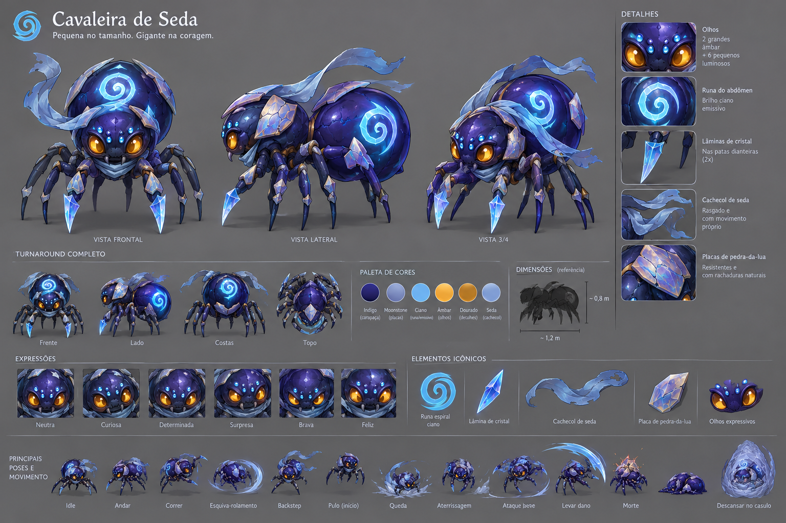

# Histórico de versões

O que entrou em cada versão, da mais nova para a mais antiga. O estado atual do jogo está no README.

## IA dos caçadores — eles desistem (13/11)

- **Interesse:** sapos, irmãs e morcegos têm um medidor de interesse em você. Ver você enche; sumir de vista, ficar num fio sobre o abismo (onde ele não alcança), se afastar demais de onde a caça começou (26 m) ou correr atrás sem chegar perto esvaziam. Com fome ele insiste mais; de barriga cheia larga rápido.
- **Desistência:** com o interesse zerado ele volta à rotina e fica 14 s ignorando você (a menos que você encoste, a 5 m).
- **Troca de presa:** com pouco interesse, uma larva por perto ganha a disputa e ele vai comer.
- **Revide:** bater num bicho enche o interesse e ele foca em você por uns segundos.
- **Encostar acorda o bicho:** a menos de ~2 m um bicho acordado sente você mesmo de costas e no escuro.
- Lagarto (emboscada) e Centopeia (chefe) continuam como antes.
- Teste novo: `caca_test`.

## Revisão geral (13/11)

- README reorganizado (estado atual) e histórico movido para este arquivo.
- Casulo: não dá para descansar com um bicho te caçando a menos de 14 m (o botão mostra "Perigo por perto"). Antes dava para abrir o menu no meio da luta e curar tudo.
- Investida: se a esquiva for interrompida, a aranha volta a colidir com os bichos (antes podia ficar atravessando tudo).
- Voo do fio (Q): sair do voo por qualquer motivo pousa o corpo e recolhe o fio.
- Olhos de Cristal aumentam a luz da visão na hora (antes só depois de recarregar).
- Lista de controles mostra o custo real do fio-guia (3 com Fio Leve).

## Novidades da v0.8 — golpes e fio da protagonista

- **Golpes como os dos inimigos:** cada golpe do combo desenha o **cone** no chão (azul), que enche até o instante do corte; o Corte em Espiral desenha um anel.
- **Mordida com bote:** a mordida avança. Se há um bicho perto na mira (até 2,6 m), ela pula até encostar nele e crava; sem alvo, dá um passinho. O cone dela é verde (veneno).
- **Sem piscar amarelo:** os inimigos não brilham mais em amarelo ao atacar. O aviso é só a marca no chão (a Centopeia e o Morcego ganharam marcas também).
- **Fio (Q) de verdade:** o fio sai da boca da aranha e voa até o alvo, ondulando. Na parede, ela espera prender, arranca, voa num arquinho e freia; o fio encurta junto e recolhe quando ela chega (não fica mais uma reta parada que ela atravessava). Errou: o fio cai.
- **Puxão melhor:** o bicho puxado sai do chão, vem até a sua frente e fica tonto um instante (dá para morder com crítico).

## Novidades da v0.8 — props e a Mãe em 3D

- **A Mãe:** corpo e pata novos. Na Fuga (B6) ela corre com as 8 patas presas nos encaixes do corpo, dobrando as juntas a cada passo; na Despensa (B5) a pata gigante se arqueia do alto até o chão.
- **Props:** ovo, casulo, presa embrulhada, cristal, pilar de teia, 3 estalagmites, 3 rochas, 2 fungos e a teia de canto. As estalagmites viram os pilares das Galerias (a altura continua variando) e enfeitam as cavernas junto com as rochas.

## Novidades da v0.8 — menu do casulo

Feito a partir do design escolhido pelo criador. **E perto de um casulo** abre o menu (o jogo pausa):

- **Retrato** da Cavaleira à esquerda (arte 2D recortada do design do menu; o Filhote aparece menor).
- **Habilidades:** uma teia com 17 nós. O centro (Fiandeira) já vem aprendido; dá para aprender um nó ligado a outro que você já tem. Cada nível dá **1 Ponto de Habilidade** (saves antigos recebem os pontos dos níveis que já tinham). Ramos:
  - Lâmina (para cima): Garras Afiadas, Corte em Espiral (Cavaleira), Investida.
  - Teia (direita): Fio Leve, Puxão, Teia Venenosa.
  - Runa (esquerda): Runa Oculta, Pulso Espiral, Olhos de Cristal.
  - Corpo (para baixo): Carapaça, Glândula Cheia, Estômago de Ferro.
  - Diagonais: Sangue Frio, Tecelã Veloz, Paladar Caçador, Passos de Seda.
  Todas mudam ações que já existem; nenhuma precisa de tecla nova.
- **Evolução:** a árvore de formas, o progresso até a muda e o que ela muda. Os ramos ficam trancados até o Ato 2.
- **Despensa:** embrulhe as presas mortas por perto (10 de Seda cada, até 8) e coma depois. Embrulhadas não apodrecem.
- **Barra de baixo:** PV, Energia, Seda, Saciedade, nível, XP, pontos e **Descansar (salvar)**. Quando dá para evoluir, o botão vira "Muda e descanso". **Esc** sai sem descansar.
- Mouse, teclado (setas, Enter, 1-2-3 ou Tab troca a aba) e controle (LB/RB trocam a aba).
- Fontes: Cinzel e Alegreya Sans (SIL Open Font License, em `assets/fonts`).

## Novidades da v0.8 — Opções e 3 espaços de save

- **Opções** (menu inicial e pausa), em três abas:
  - **Som:** volume geral, música, efeitos e dublagem.
  - **Tela:** tela cheia, brilho (para telas escuras; a caverna continua escura de propósito) e mostrar ou esconder a lista de controles.
  - **Controles:** troque qualquer tecla do teclado/mouse e qualquer botão do controle. Se a tecla já era de outra ação, as duas trocam de lugar. Esc cancela; há "Restaurar controles padrão". A lista de controles do jogo mostra as teclas novas.
- **3 espaços de save:** Novo jogo pergunta em qual espaço começar (e confirma antes de apagar um cheio); Carregar escolhe qual continuar. O save antigo vira o Espaço 1.
- As opções ficam em `user://opcoes.cfg` e valem para todos os espaços.

## Novidades da v0.8 — a Cavaleira ganhou corpo

- **Modelos da protagonista:** corpo, segmento de pata e lâmina de cristal. As 8 patas saem dos encaixes que vieram no modelo e usam a peça do segmento (com IK, como antes).
- **Lâminas de cristal:** duas foices na frente do corpo, só depois da muda (o Filhote não tem). Cada golpe do combo mexe uma: 1º a direita varre, 2º a esquerda, 3º as duas descem juntas.
- O cachecol de caixas saiu quando o modelo está presente.

## Novidades da v0.8 — pilares, ganchos e a ponte de fio

- **Pilares de verdade:** cada âncora virou uma estalagmite feita em código, torta e facetada, com pontas menores e cascalho em volta. Altura, grossura, inclinação e formato (simples, gêmeas, monte baixo, agulha com anéis) variam pelo nome do pilar: o mesmo pilar sai sempre igual, mas nenhum é gêmeo do outro. Algumas têm veios de cristal que ajudam a achar no escuro. A colisão continua a mesma (o puzzle não muda).
- **Ganchos de parede:** chifres de rocha saindo da parede, com uma lasca de cristal na ponta. Só aparecem **em pares, um de cada lado dos bolsões de abismo** (10 nas Galerias): um fio entre eles é uma rota de fuga por cima do buraco. Ficam raros de propósito para a rede continuar sendo de pilares.
- **Ponte de fio nova:** dois cabos torcidos nas bordas, um fio no meio, trama em zigue-zague meio torta, um véu de seda bem fino, gotas de orvalho e amarras que sobem em leque até um nó de seda enrolado no pilar. Tudo gerado em código, então **não precisa de modelo** (cada fio tem um comprimento diferente).
- Se um dia chegarem os modelos `estalagmite_a/b/c`, eles substituem a rocha gerada sozinhos.

## Novidades da v0.8 (etapa 3) — Galerias orgânicas em dois andares

- **Caverna orgânica:** o oeste (Entrada, Poça rasa, Túnel dos morcegos, Grande Gruta, Jardim, Ninho dos lagartos) e o leste (Galeria do eco, Acampamento, Antecâmara) agora são uma caverna gerada por **autômato celular**: salões de formato livre que se emendam, nichos, becos sem saída e bolsões de abismo. O mapa encolheu 1/3 (cerca de 150 × 108 m por andar).
- **Câmaras feitas à mão continuam onde a história precisa:** Ponte quebrada, Lago escondido, abismo da Galeria do eco, Fresta de cristal, Poças ácidas, Subida antiga (parede de cristal), Covil da Centopeia e Borda da Fenda. Em volta das travas a caverna gerada não abre atalho.
- **Profundezas (P1–P6):** o andar de baixo é todo orgânico. Qualquer abismo do andar de cima (as fendas da Ponte, o abismo do eco, os bolsões no meio dos salões) leva para lá, bem embaixo de onde você caiu, com 35% da vida a menos. Duas **rampas** (Poça rasa e Antecâmara) ligam os andares. Os poços das Profundezas, o abismo da Subida antiga e a Fenda não têm fundo.
- **Cerca de 60 criaturas**, incluindo cinco **irmãs caçadoras**, irmãs que fugiram do ninho e caçam a Filhote pelo cheiro.
- **Mapa (M) por andar**, com as rampas marcadas.
- A caverna é sempre a mesma (semente fixa em `galerias.gd`: `UPPER_SEED` e `LOWER_SEED`). Para ver outra, troque a semente e rode `tests/preview_organic.tscn`, que gera os PNGs.

## Novidades da v0.8 (etapa 2) — escuro e quedas

- **Visão curta:** a caverna ficou quase preta. Você enxerga só um círculo pequeno em volta da aranha (3,5 m na Filhote, 5,5 m na Cavaleira) e o que tem luz: fungos, a isca do lagarto, fogo, olhos e os avisos de golpe. Na fase da Caça os fungos apagam e sobra quase só a sua luz. A runa acesa ilumina mais, mas denuncia você.
- **Quedas:** cair num abismo agora tem consequência. Abismo com andar de baixo: tira 35% da vida e você acorda lá embaixo, tendo que achar o caminho de volta. Abismo sem fundo: morte (e o ato recomeça). O lago continua só te devolvendo para a margem. Os andares de baixo chegam com o mapa novo (etapa 3); até lá, as fendas atuais são sem fundo.

## Novidades da v0.8 (etapa 1) — hardcore: combate e IA

- **Golpes estilo Monster Hunter:** cada bicho tem 3 ou 4 golpes. Antes de cada um aparece uma **marca laranja no chão** com a área, que enche até o golpe sair. O golpe vai até o fim mesmo que você saia andando (só a esquiva ou estar fora da marca salva), mira onde você **vai estar** e gira atrás de você. Depois do golpe o bicho fica parado um instante: é a hora de bater.
  - **Sapo:** bote, língua (puxa você e emenda um bote), salto esmagador e **giro de língua** contra quem fica rodando do lado dele. Furioso: cuspe ácido que deixa poça.
  - **Lagarto-lanterna:** mordida, investida em linha, chicote de cauda (quem fica do lado/atrás). Furioso: clarão da isca que te deixa lenta.
  - **Irmã faminta:** mordida, pulo, teia cuspida (deixa lenta). Furiosa: frenesi de mordidas em sequência.
  - **Morcegos:** até 3 mergulham juntos, miram à frente de quem corre e **gritam** — o grito te deixa lenta e chama todo predador por perto.
- **Fúria:** abaixo da metade da vida o bicho fica furioso: avisa menos, bate mais forte e ganha um golpe novo.
- **Perseguição que não desiste:** quem te caça segue seu barulho e seu cheiro. Só despista quem **some de vista e fica quieta** (parada, runa apagada). Aí ele ainda vasculha a área uns segundos antes de desistir.
- **Filhote frágil:** dois golpes de qualquer predador matam. A vida quase não regenera sozinha.
- **Teia por tamanho:** bicho P fica preso; M (sapo, lagarto) fica preso uns 2 s e **rasga a teia**; G (Centopeia) arrebenta na hora. Bicho andando que esbarra num fio no chão também enrosca (e o M arrebenta o fio).
- **Morte permanente por ato:** morreu, o ato recomeça do início com o nível, a forma e os itens de quando você entrou nele. Fica só o conhecimento: o mapa descoberto e as falas. O casulo continua salvando para você sair e voltar (Continuar).

## Novidades da v0.7 — mais difícil e você vira a presa

Resposta ao primeiro teste ("monótono e fácil, ninguém me caça, já começo forte, o tutorial acaba do nada, as patas estão ruins").

- **Você começa como Filhote de Seda:** 70% do tamanho, 50 PV, garra fraca (um sapo aguenta vários golpes). Para matar algo maior, use teia de captura, veneno e armadilhas de fio. Bicho maior que você te enxerga como comida.
- **Evolução:** no **nível 8**, descanse num casulo e ela faz a muda para **Cavaleira de Seda**: lâminas de cristal, 110 PV de base, golpes mais fortes e o nível volta a 1. Os cristais que você já comeu continuam valendo. Depois da muda, só bicho faminto de verdade arrisca te caçar.
- **Os predadores te caçam:** com fome, sapos, morcegos (só a Filhote), irmãs e a Centopeia seguem seu cheiro mesmo sem te ver. A estimativa deles melhora quanto mais perto estão. Quando alguém começa a te seguir, aparece uma **seta vermelha na borda da tela** apontando para ele (mais forte quanto mais perto).
- **Fim do prólogo:** sair do Berçário agora tem epílogo, um cartão "Fim do prólogo" e fala da protagonista antes de escurecer. Cada camada abre com escurecimento e um título (nome + ato).
- **Patas novas:** andar de aranha de verdade (dois grupos de quatro patas alternados). As patas pisam no chão, miram onde o corpo vai estar e não esticam mais para trás nem sobem nas paredes.

- **Menu inicial:** Continuar (mostra onde e em que nível está o save), Novo jogo (pede confirmação antes de apagar), Controles e Sair. **Esc** no jogo abre a pausa com Voltar ao jogo, mostrar/esconder controles, Menu inicial e Sair.

**Saves antigos:** no menu inicial escolha **Novo jogo**. O balanço mudou e o jogo começa na forma Filhote.

## Novidades da v0.6 — mundo vivo

A caverna agora vive sozinha, como os mapas de Monster Hunter: cada criatura tem necessidades, rotina e toca, e circula pelo mapa mesmo longe de você.

- **Ciclo da caverna (5 min):** os fungos acendem e apagam. No **Brilho**, larvas saem para pastar musgo e os caçadores dormem. Na **Caça**, sapos, lagarto, morcegos e a Centopeia acordam. A fase aparece embaixo do minimapa.
- **Necessidades:** fome, sono, medo e vontade de passear. Um "cérebro" escolhe a atividade de maior nota: dormir na toca, comer, fugir, passear para outra câmara, brigar ou lutar com você.
- **A Centopeia patrulha o leste** (G8, G9, G11, G13, G14): caça sapos e larvas, deixa rastro de arrasto, arrebenta fios por onde passa, dorme no covil e, ferida, **foge mancando para o covil** para se curar. O estrago fica: morrer não cura a Centopeia. Quando ela chega na câmara onde você está, o chão treme.
- **Morcegos em bando:** dormem pendurados no Brilho e saem juntos na Caça para caçar larvas em outras câmaras. Fios esticados no caminho deles viram armadilha.
- **Hierarquia e território:** bicho menor foge do maior (o sapo foge da Centopeia). O Lagarto-lanterna expulsa sapos do jardim. Quem é atacado por outro bicho revida. Dormindo, o lagarto quase apaga a isca: é a hora de passar.
- **Rastreio pela teia:** bichos dentro do seu território aparecem como pontos no minimapa (cor pelo tamanho). A **Leitura** (Alt) mostra o que a criatura está fazendo e como ela parece (com fome, com sono, ferida).
- **Mais rápido:** as criaturas andam presas à grade de navegação, sem testar colisão contra a malha da caverna (a física caiu de ~15 ms para ~3 ms por quadro com 20+ criaturas). Longe de você, elas pensam 1× por segundo em vez de 4×.

## Novidades da v0.5 — o Ato 1 inteiro

- **Galerias completas (G1–G15):** depois da Ponte quebrada vêm a Galeria do eco, o Acampamento, a Fresta de cristal (secreta, só para quem é pequena), a Antecâmara, o Covil da Centopeia e a Borda da Fenda. O Ninho dos lagartos (ao sul do jardim) e as Poças ácidas (atalho do jardim até a Antecâmara) também abriram.
- **Chefe: Centopeia-blindada.** Corpo de 12 segmentos que segue a cabeça. Ela sente a **vibração** do chão: correr vibra mais, ficar parada ou andar **sobre um fio** te esconde. Morde de perto e **investe** em linha reta. A carapaça segura 90% do dano e o veneno não entra. Para abrir a carapaça, faça a Centopeia investir **através de um fio esticado**: ela se enrosca por 4,5 s e leva dano cheio (e o crítico ×2). Na metade da vida, ela se enfurece. A arena fecha durante a luta; se você morrer, ela volta a dormir com a vida cheia.
- **Pele de Cristal:** comer a carapaça dá +20 PV máximo e -20% de dano recebido.
- **Fim do Ato 1:** na Borda da Fenda o chão cede e a Cavaleira cai no Abismo (por enquanto, só a sala onde ela acorda).
- **Aventureiros vistos de longe:** na Galeria do eco, três humanos com tochas passam do outro lado do abismo, e a câmera vira para mostrar.
- **Fogo queima teia:** as tochas do acampamento queimam fios e teias de captura por perto.
- **Anotações e cristais (E):** o diário da expedição no acampamento e uma visão estranha na Fresta de cristal.
- **Resistência a Ácido:** cada Sapo-de-rocha comido dá +1. Com 3, as Poças ácidas não queimam.
- **Caverna gerada 4× mais rápido** (as Galerias inteiras montam em menos de 2 s).

## Novidades da v0.4

- **Galerias Úmidas, primeira parte (G1–G7):** a camada depois do Berçário, com a Grande Gruta como centro. Dois caminhos levam até ela (a poça do sapo ou o túnel dos morcegos), o Jardim de musgo fica ao sul, o Lago escondido a sudoeste e a Ponte quebrada a leste. A Subida antiga (G16) já aparece atrás de uma parede de cristal.
- **Morcego-eco:** bando que voa e caça pelo som. Ouve quem se mexe; ficar parada faz você sumir. Mergulha para morder (só dá para acertar durante o mergulho). Um fio esticado no caminho ou um fio lançado com **Q** derruba o morcego.
- **Lagarto-lanterna:** a isca de luz atrai larvas, que ele come. Defende o território: pisca a isca como aviso e depois morde ou dá uma investida. A luz revela você de perto mesmo com a runa apagada. Comer o lagarto dá +10 de Energia máxima (uma vez).
- **Primeiro território:** na Grande Gruta, um casulo e três fios ligados a ele formam o território.
- **Lago escondido:** só uma corrente de fios (margem → pedrinha → ilha) leva ao cristal de energia.
- **Modelos 3D:** o jogo troca as formas cinza pelo modelo assim que o arquivo existe em `assets/models/`. Já entraram a **irmã-aranha** e o **Sapo-de-rocha**.

## Novidades da v0.3

- **Cavernas orgânicas:** o Berçário deixou de ser feito de blocos. Câmaras viram bolhas e elipses de borda irregular, túneis são curvos, as paredes têm altura variável (altas ao norte, baixas ao sul para não tapar a câmera), os abismos têm penhascos e há estalagmites e pedras espalhadas. Tudo gerado por `systems/level/cave_builder.gd`.
- **Trajeto menos reto:** corredor curvo, a fenda do Salão das teias corta o salão na diagonal, um túnel de fuga sinuoso, uma **trilha baixa** alternativa entre B1 e B3 e um nicho escondido no corredor.
- **A Mãe segue o túnel** curvo na fuga, em vez de andar em linha reta.
- **Mapa com a forma real** das câmaras (e abismos mais escuros).

## Novidades da v0.2

- **Berçário jogável (B1–B6):** as 6 câmaras do mapa do GDD em formas cinza — irmãs-aranha, o primeiro fio sobre um abismo, a fresta secreta com o cristal, a pata da Mãe (furtividade) e a fuga da Mãe.
- **Patas com IK:** as 8 patas pisam no chão de verdade, dão passos alternados e ficam penduradas sobre o abismo. As irmãs usam o mesmo sistema.
- **Mapa automático:** minimapa no canto e mapa completo na tecla **M**. As câmaras aparecem quando você entra nelas; travas vistas (como a fresta) ficam marcadas.
- **Camadas:** o jogo começa no Berçário e o túnel de saída leva às Galerias (por enquanto, a câmara de teste da v0.1). O save lembra em qual camada você estava.
- **Dicas de tutorial** ao entrar em cada câmara do Berçário e 10 falas novas para dublar.

Documento de design (GDD): https://claude.ai/artifact/1GWcAejdRMa5iN3mmC9C1K

